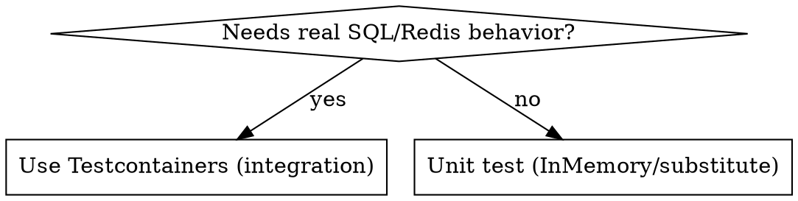

# HrastERP Testing Conventions

## Stack

| Package | Rule |
|---|---|
| **xUnit** | `xunit` is a global using — do NOT add `using Xunit;` |
| **FluentAssertions** | Always use `.Should()` — NEVER use `Assert.*` |
| **NSubstitute** | Substitute interfaces only — never concrete test infrastructure types |
| **Testcontainers.PostgreSql / .Redis** | Real containers for tests that need SQL or Redis behavior |

---

## Naming Convention

```
ExpectedBehavior_When_Condition
```

- `When` is always capitalized
- State expected outcome first, then the condition
- No `Test` prefix, no `Should` prefix

```
Returns_success_When_credentials_are_valid
Returns_invalid_credentials_When_email_is_not_found
Throws_InvalidOperationException_When_TenantId_is_empty_on_insert
Sets_CreatedAt_and_CreatedBy_When_entity_is_added
Removes_all_matching_keys_When_prefix_matches
Has_expected_default_values_When_instantiated
Fails_validation_When_required_field_is_missing
```

---

## Test Type Decision



### Use Testcontainers (real database) for

- **EF Core interceptors** — `AuditableEntityInterceptorTests`, `SoftDeleteInterceptorTests`, `TenantEntityInterceptorTests`, `AuditLogInterceptorTests`. EF Core's change tracking pipeline is not replicated by InMemory.
- **EF Core query filters** — `SoftDeleteQueryFilterTests`, `TenantQueryFilterTests`. Must be verified against a real SQL engine.
- **`AuthServiceTests`** — full login/refresh/logout flow writes refresh tokens; requires real migrations.
- **`RedisCacheServiceTests`** — `RemoveByPrefixAsync` uses Redis SCAN; unavailable in InMemory.

### Use InMemory / NSubstitute for

Settings validation, pipeline behavior logic, domain entity logic, cleanup job property tests, service method logic — anything that does not exercise SQL-specific behavior.

---

## Unit Tests

All external dependencies (interfaces: `ICurrentUser`, `ICurrentTenant`, `IRecurringJobManager`, etc.) are replaced with NSubstitute substitutes.

```csharp
public class MyServiceTests
{
    private readonly ICurrentUser _currentUser = Substitute.For<ICurrentUser>();
    private readonly ICurrentTenant _currentTenant = Substitute.For<ICurrentTenant>();

    [Fact]
    public void Returns_success_When_user_is_authenticated()
    {
        _currentUser.IsAuthenticated.Returns(true);

        var result = new MyService(_currentUser, _currentTenant).DoSomething();

        result.IsSuccess.Should().BeTrue();
    }
}
```

**Do NOT substitute:** `TestDbContext`, `TestEntity`, test data records, or concrete subclasses of abstract base classes.

---

## Integration Tests

Tag all integration tests so they can be filtered:

```csharp
[Trait("Category", "Integration")]
```

### PostgreSQL fixture

```csharp
public class MyInterceptorTests : IClassFixture<PostgresContainerFixture>, IAsyncLifetime
{
    private readonly PostgresContainerFixture _fixture;
    private HrastDbContext _dbContext = null!;

    public MyInterceptorTests(PostgresContainerFixture fixture) => _fixture = fixture;

    public async Task InitializeAsync()
    {
        // Each test gets an isolated database
        _dbContext = new HrastDbContext(new DbContextOptionsBuilder<HrastDbContext>()
            .UseNpgsql(_fixture.NewConnectionString())
            .Options, ...);
        await _dbContext.Database.MigrateAsync();   // use EnsureCreated() for TestDbContext
    }

    public Task DisposeAsync() => _dbContext.DisposeAsync().AsTask();

    [Fact]
    [Trait("Category", "Integration")]
    public async Task Sets_CreatedAt_and_CreatedBy_When_entity_is_added()
    {
        // arrange / act / assert using _dbContext
    }
}
```

- `NewConnectionString()` returns a fresh `test_{Guid:N}` database — call once per test for isolation.
- Use `EnsureCreated()` with custom `TestDbContext`; use `MigrateAsync()` with the real `HrastDbContext`.

### Redis fixture

```csharp
public class RedisCacheServiceTests : IClassFixture<RedisContainerFixture>, IAsyncLifetime
{
    private readonly RedisContainerFixture _fixture;
    private RedisCacheService _cache = null!;

    public RedisCacheServiceTests(RedisContainerFixture fixture) => _fixture = fixture;

    public async Task InitializeAsync()
    {
        var mux = await ConnectionMultiplexer.ConnectAsync(_fixture.ConnectionString);
        _cache = new RedisCacheService(mux);
    }

    public Task DisposeAsync() => Task.CompletedTask;
}
```

Connect inside `InitializeAsync` — constructor cannot be async.

---

## Common Mistakes

| Mistake | Correct |
|---|---|
| `Assert.Equal(expected, actual)` | `actual.Should().Be(expected)` |
| `Assert.True(result.IsSuccess)` | `result.IsSuccess.Should().BeTrue()` |
| `using Xunit;` at top of file | Not needed — global using |
| `Should_return_success_when_valid` | `Returns_success_When_credentials_are_valid` |
| Substituting `TestDbContext` | Keep it as a concrete class |
| InMemory for interceptor/filter tests | Use Testcontainers |
| Missing `[Trait("Category", "Integration")]` | Add to every integration test |

---

## Running Tests

```bash
# Fast only (no Docker)
dotnet test --filter "Category!=Integration"

# All tests (Docker required)
dotnet test

# Integration only
dotnet test --filter "Category=Integration"

# Single project
dotnet test tests/HrastERP.Infrastructure.Tests/

# Single test
dotnet test --filter "FullyQualifiedName~Returns_success_When_credentials_are_valid"
```
